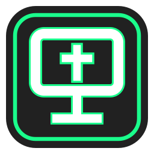

# Regemark Present

Presentation software for running church services. You build songs and slides, then send them to several screens at the same time: projectors and monitors through the graphics card, NDI over the network, and SDI through Blackmagic DeckLink cards.

## What works today (milestone 1)

| Area | Status |
|---|---|
| Song library with search (title, lyrics, author, CCLI #) | ✅ |
| Playlists with section headers and drag-to-reorder; at the end of a song, "next" moves on to the next song | ✅ |
| Import from SongSelect: `.usr`, lyrics `.txt` and ChordPro, via the menu or drag and drop | ✅ |
| New song from pasted lyrics (SongSelect "copy lyrics" works as-is) | ✅ |
| Slide editor: rich text per word (bold, italic, underline, colour, size), several text boxes, box position, font, outline, shadow, alignment, shrink-to-fit | ✅ |
| Transition per slide (cut, fade, slide left, slide up, zoom) with a default per song | ✅ |
| Build-in animation per text box (fade, rise, zoom, wipe) with a delay and duration | ✅ |
| **Backgrounds per slide that change as the song goes on**: each slide can set a colour, image or looping video, and later slides keep it until another slide sets a new one | ✅ |
| Media bin over any folders (e.g. your Sunday Screens downloads): send live, apply to selected slides, or apply to the whole song | ✅ |
| Screens: **Audience**, **Confidence** (current and next slide, clock, notes, group label), **Stream overlay** (transparent lower third) | ✅ |
| Per-screen settings: show/hide backgrounds and text, transparency, its own text position and style, band behind the text | ✅ |
| Outputs per screen, any combination: monitor/projector, **NDI** (with alpha), **DeckLink SDI** (with external fill + key) | ✅ (DeckLink needs the SDK at build time, see below) |
| Clear all / background / text (F1 / F2 / F3) and keyboard control | ✅ |
| Windows installer (Inno Setup) built by GitHub Actions | ✅ |

## Running a service

1. **Screens → Screen setup…** For each screen, tick where it should go: a monitor, NDI, or DeckLink.
2. Drag SongSelect downloads onto the window, or use **Import SongSelect files…** (Ctrl+I).
3. Create a playlist and add songs to it (double-click a song in the library).
4. Click a slide to put it live. Use Space or → to go forward and ← to go back.
5. Click **+** in the media bin to add your backgrounds folder. Double-click an item to send it live, or select slides and click **→ Selected slides** so each one changes the background as the song goes on.

## SongSelect

CCLI only opens the SongSelect API to approved partners. Until you get partner access, this app imports the files that SongSelect lets subscribers download:
- **USR**: the "Download → USR" option, which includes the metadata.
- **Text**: the "Download → Lyrics (TXT)" option.
- **ChordPro**: from a chord sheet download. Chords are removed.

Each song keeps its CCLI number, authors and copyright for CCLI reporting.

## NDI and DeckLink

- **NDI**: no build step needed. The app loads the NDI runtime when it starts. Install the free **NDI Tools** or **NDI Runtime** from ndi.video. Stream-overlay screens send BGRA with alpha, so OBS, vMix and TriCaster receive a keyable source.
- **DeckLink**: install Blackmagic **Desktop Video** on the playout machine. To build with DeckLink support, download the **Desktop Video SDK** from blackmagicdesign.com/developer, then configure with `-DDECKLINK_SDK_DIR=<sdk root>`. In CI, store the SDK zip somewhere private and set the `DECKLINK_SDK_URL` repository secret. Turn on **Fill + key** on a Stream screen to send fill on one SDI output and key on the other, for an ATEM or other switcher.

NDI® is a registered trademark of Vizrt NDI AB. DeckLink is a trademark of Blackmagic Design. SongSelect and CCLI are trademarks of CCLI.

## Building

Needs Qt 6.4 or later (Widgets and Multimedia), CMake 3.21 or later, and a C++17 compiler.

```bash
cmake -S . -B build -G Ninja -DCMAKE_BUILD_TYPE=Release
cmake --build build
QT_QPA_PLATFORM=offscreen ctest --test-dir build --output-on-failure
./build/RegemarkPresent
```

**Windows installer:** push to GitHub, and `.github/workflows/windows.yml` builds the app with MSVC and Qt 6.8, runs the self-test, runs windeployqt, and outputs `RegemarkPresent-x.y.z-Setup.exe`. Push a `v*` tag to attach the installer to a release.

Data locations:
- Library: `Documents/Regemark Present`. Each song is a `.rpres` file and each playlist a `.rplist` file, both readable JSON. Override this folder with `RP_LIBRARY_DIR`.
- Settings: `%APPDATA%/Regemark/Regemark Present/settings.json` on Windows, or `~/.config/Regemark/Regemark Present/settings.json` on Linux.

## Code layout

```
src/core     data model (presentations, slides, styles, screens), library, settings, rich text
src/render   ScreenRenderer (transitions, builds, background crossfades), text layout, MediaPool (shared video decoders)
src/show     ShowController: the single source of truth for what is live
src/output   OutputEngine (per-screen frame clock) and sinks: DisplayOutput, NdiOutput, DeckLinkOutput
src/import   SongSelect USR / TXT / ChordPro importers
src/ui       main window, slide editor, screen setup, media bin
tests        headless self-test that also writes sample frames as PNGs
```

See [docs/ROADMAP.md](docs/ROADMAP.md) for what's next.
